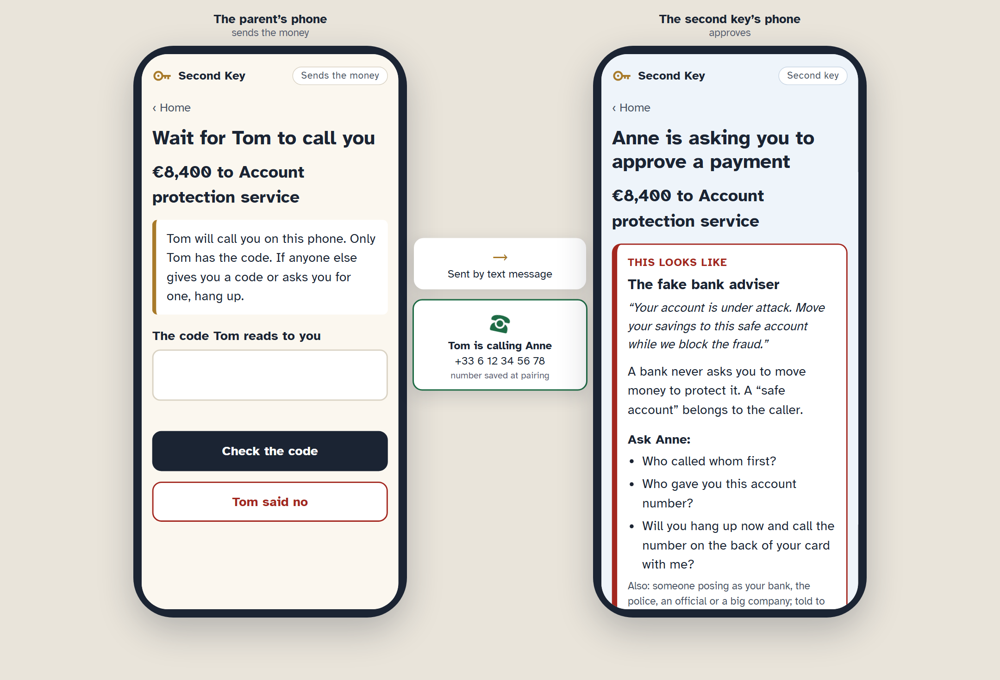
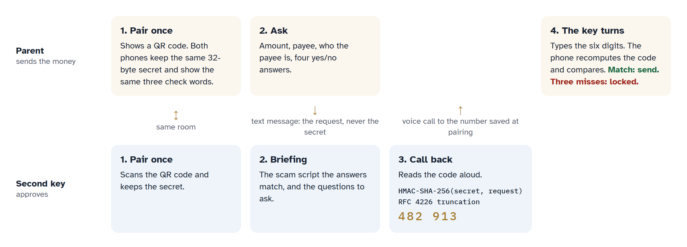
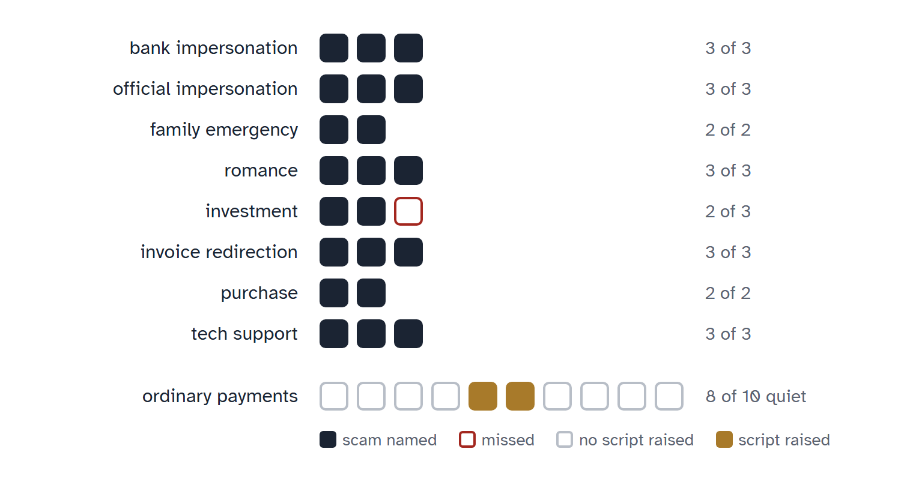

# Second Key

A two-person check a family runs before an elderly relative sends money to someone new. A trusted family member, the second key, calls them back and reads out a release code.

**Try it:** [two phones side by side](https://marc-dvci.github.io/Second-Key/demo.html) · [the app on your own phone](https://marc-dvci.github.io/Second-Key/) · **Video (2:11):** https://youtu.be/9ZTDW2QXfXk



## Why

A bank never lets one person move a large sum to a new beneficiary alone. It applies dual control, and it calls back on a number it already holds. Families have neither, and fraudsters work on exactly that gap: in France, manipulation fraud reached **€516 million in 2025, up 34% in a year**, and the fake bank adviser who asks for a transfer to a "safe account" is its most frequent form ([Banque de France, OSMP annual report 2025](https://www.banque-france.fr/system/files/2026-09/Rapport_2025_de_l_OSMP.pdf)).

Second Key moves the bank's two controls into the family, whichever bank the parent uses:

1. **Pairing, once, in the same room.** The parent's phone shows a QR code; the second key's camera opens it. Both phones keep the same secret and show the same three check words.
2. **A request in four questions.** Before paying someone new, the parent enters the amount and the payee, says who the payee is, and answers four yes/no questions. The request goes to the second key by text message.
3. **A briefing for the call.** The second key sees the request and the scam script the answers match, for example "The fake bank adviser", with the questions to ask.
4. **A call-back on the saved number.** The second key calls the parent on the number saved at pairing. If they agree, they read a six-digit code aloud.
5. **The key turns, or the payment stops.** The parent types the code. If the second key refuses, the parent's screen says: do not send the money, hang up, call your bank on the number on your card.

## The release code

The code only reaches the parent by voice, on a call the second key makes.



- Both phones compute it as HMAC-SHA-256 over the request (pairing id, request id, amount, payee, payee type, the four answers, time), keyed with the 32-byte secret shared at pairing, and reduced to six digits with the dynamic truncation of RFC 4226. The truncation is tested against the RFC 6238 SHA-256 test vectors. Code: [`src/core/code.ts`](src/core/code.ts).
- The request link carries the request, never the secret, and rides in the URL fragment, which browsers do not send to the web server. Code: [`src/core/links.ts`](src/core/links.ts).
- The parent's phone never displays the code. It recomputes it only to compare with what the parent types, and locks the request after three wrong codes.
- A code made for one request does not unlock another, and changing the amount or the payee in a link changes the code. A changed copy of a request the second key has already seen is refused outright.

## Scam scripts and evaluation

The second key's briefing comes from a fixed table of eight scripts in [`src/core/scripts.ts`](src/core/scripts.ts): the fake bank adviser, impersonation of a bank, the police, an official or a big company, changed bank details, the family emergency message, someone known only online, an offer that came to the parent, secrecy, and pressure. The app names a script or says that none matched, with no score, and every request to someone new goes to the second key either way.

The table was committed before the evaluation cases were added. On 22 scam cases paraphrased from public warning pages (FTC, FBI and IC3, cybermalveillance.gouv.fr, Take Five, investor.gov, ANZ) and 10 ordinary payments:

| Measure | Result |
|---|---|
| Scam cases where the main script names the right family | **21 of 22** |
| Ordinary payments with no script raised | 8 of 10 |



The missed case is an investment website the person found on their own. The two ordinary payments that raise a script are a firm that changed its bank details and a marketplace seller known only online, which are the cases where a call-back is worth making. Every case, its answers and its source: [`docs/evaluation.md`](docs/evaluation.md). Regenerate with `npm run evaluate`; CI fails if the committed file is out of date.

## Privacy

Everything stays on the two phones: each phone keeps its pairing and receipts in its own browser storage. The only thing that leaves the parent's phone is the text message the parent sends.

## Run it

Requires Node 24.

```bash
npm install
npm run dev
```

Open `http://localhost:5173/Second-Key/demo.html` for both phones side by side. To use two real phones on the same network, run `npm run dev -- --host` and open the printed address on each phone.

| Command | What it does |
|---|---|
| `npm test` | Unit tests: release code, RFC vectors, links, amounts, scam scripts |
| `npm run e2e` | Browser tests: pairing two separate phones, the full journey, a tampered link, refusal, lock, receipts, and an axe WCAG 2.2 AA scan of every screen |
| `npm run evaluate` | Runs the scam scripts over `cases/cases.json` and writes `docs/evaluation.md` |
| `npm run figures` | Draws the two figures above into `docs/images/` from the same code |
| `npm run build` | Type check and production build into `dist/` |

Every push to `main` runs the unit tests and the evaluation, builds, and deploys to GitHub Pages.

## Project map

```
src/main.ts            router: incoming pairing and request links, screen by stored state
src/core/code.ts       secret, check words, release code
src/core/links.ts      pairing and request payloads in the URL fragment
src/core/request.ts    request type, the four questions, canonical text
src/core/scripts.ts    scam script table
src/core/rules.ts      matchScripts()
src/state/storage.ts   per-phone storage, one namespace per demo phone
src/ui/views/          one file per screen
src/demo.ts            the two-phone demo page
cases/cases.json       evaluation cases with sources
devpost/               scope, product requirements, technical spec, build checklist
```

The project was planned with the [Devpost Learn skill pack](https://github.com/challengepost/learn-ai-basics): [`devpost/scope.md`](devpost/scope.md), [`devpost/prd.md`](devpost/prd.md), [`devpost/spec.md`](devpost/spec.md) and [`devpost/checklist.md`](devpost/checklist.md) were written before the code, and each build slice in the checklist is one commit.

## Scope

- The parent makes the payment in their own bank's app once the key turns, so Second Key works with any bank. It works when the family agrees to use it before money goes to someone new.
- Request links open in the browser used for pairing. Inside a messaging app's built-in browser, the screen asks for the link to be opened in that browser.
- English interface, amounts in euros.

## License

[MIT](LICENSE)
